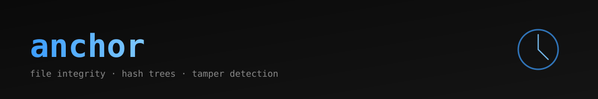

<p align="center">
  
</p>

<p align="center">
  <b>File integrity monitor</b> — baseline, live watch, webhooks, content hints.<br>
  SHA-256 in-tree · zero dependencies · Linux / macOS / Windows
</p>

<p align="center">
  
  
  
</p>

---

## Why

Someone always asks: *did this tree change?*  
Servers, containers, release artifacts, compliance — **anchor** freezes a SHA-256 baseline and can sit as a live daemon that prints (and optionally webhooks) the moment anything moves.

## Install

```sh
cargo install --path .
# or
cargo build --release && ./target/release/anchor --help
```

## Commands

```sh
# 1. Freeze a tree
anchor init /etc
# → .anchor/baseline

# 2. One-shot audit
anchor check /etc --diff
#   ~ ssh/sshd_config
#       hash a1b2c3d4e5f0 → 9f8e7d6c5b4a
# FAIL — 1 issue(s), 140 unchanged

# 3. Live daemon (pure-std poll)
anchor watch /etc --diff --interval 500
# [14:02:11] ~ ssh/sshd_config  a1b2c3d4e5f0→9f8e7d6c5b4a
# [14:02:11] + tmp/evil.sh

# 4. Alert to Discord / generic webhook
anchor watch /etc --webhook http://127.0.0.1:9000/hook
anchor check /etc --webhook https://discord.com/api/webhooks/ID/TOKEN --diff

# 5. Single-file hash
anchor hash ./Cargo.toml
```

### Flags

| Flag | Effect |
|------|--------|
| `--diff` | Print hash / mode deltas and content hints |
| `--webhook <url>` | POST JSON alert on drift (Discord-compatible body) |
| `--interval <ms>` | Watch poll interval (default `1000`) |

Exit codes: `0` clean · `1` drift · `2` error.

## What it tracks

- **SHA-256** of every regular file (FIPS 180-4, no OpenSSL)
- **Size** and **mtime**
- **Unix mode** bits (`m` marker on permission-only changes)
- Symlinks are **not** followed

Default ignores: `.git`, `.anchor`, `target`, `node_modules`, `.DS_Store`, `Cargo.lock`.

## Live watch

`anchor watch` re-scans the tree every `--interval` milliseconds. No external crates — works the same on Linux, macOS and Windows. For sub-second reaction on large trees, lower `--interval` (CPU cost scales with tree size).

## Baseline format

```text
ANCHOR2
1732214400
2
ba7816bf8f01… 3 1732214400 33188 a.txt
```

Plain text. Easy to audit and `diff(1)`. `ANCHOR1` baselines still load.

## Library

```rust
use anchor::{scan, diff, save_baseline, load_baseline};

let base = scan("/etc", &[".git"])?;
save_baseline(&base, "/var/lib/anchor/etc.baseline")?;

let live = scan("/etc", &[".git"])?;
let report = diff(&base, &live, std::path::Path::new("/etc"), true);
assert!(report.is_clean());
```

## CI

`.github/workflows/ci.yml` runs `fmt`, `clippy`, `test` on Ubuntu / Windows / macOS and uploads release binaries.

## License

MIT · Copyright 2026 vantacorehq
